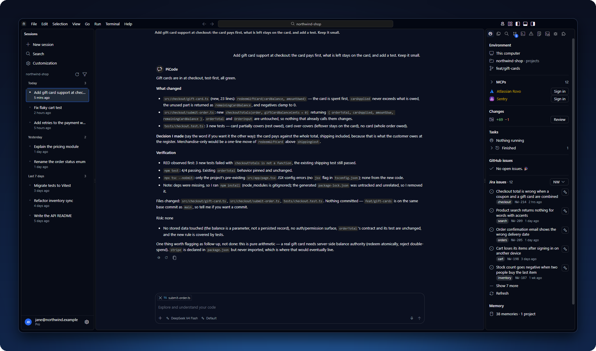
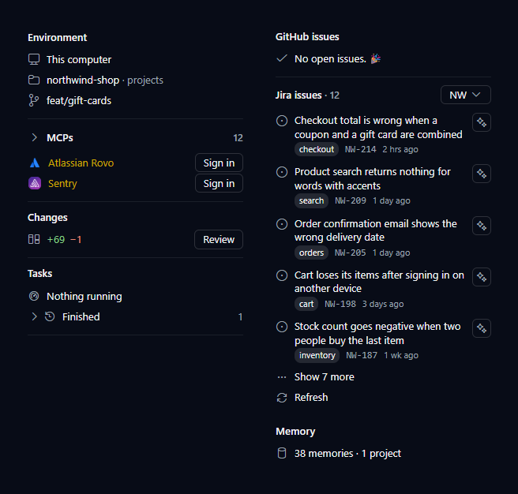
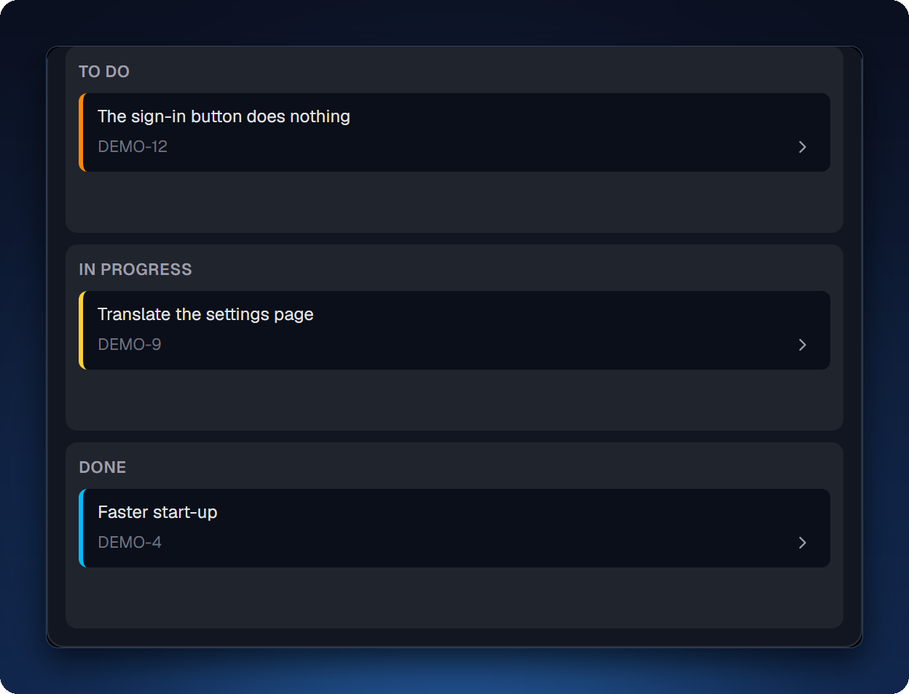

<!-- markdownlint-disable MD033 MD041 -->
<div align="center">


<h3>Your code editor, with an AI partner already inside.</h3>

<p>No plugins to hunt for, no setup ceremony. Open PiCode, connect the AI you already use,<br />and start building together.</p>

<p>
<a href="https://github.com/Tomas-Platero/PiCode/releases"></a>
&nbsp;
<a href="https://www.getpicode.app"></a>
</p>

<p>
<a href="https://github.com/Tomas-Platero/PiCode/releases"></a>
<a href="#-up-and-running-in-three-steps"></a>
<a href="./LICENSE"></a>
<a href="https://github.com/Tomas-Platero/PiCode/wiki"></a>
</p>

<br />



</div>

<br />

<table>
<tr>
<td align="center" width="33%">

### 🆓
**Free, for real**<br />
<sub>Every feature, no account, no trial. And open source.</sub>

</td>
<td align="center" width="33%">

### 🔌
**Bring your own AI**<br />
<sub>Use the ChatGPT, Claude or Copilot plan you already pay for — or any API key.</sub>

</td>
<td align="center" width="33%">

### 🧠
**It gets to know your project**<br />
<sub>Decisions and conventions carry over, so you never explain things twice.</sub>

</td>
</tr>
</table>


## 🤖 Work your way

<table>
<tr>
<td width="50%" valign="top">

#### 🤖 Agent
**When the AI does the heavy lifting.** You describe what you want, it builds it, and you review what changed. The conversation is at the heart of everything — like the picture above.

</td>
<td width="50%" valign="top">

#### 🧑‍💻 Editor
**When you're the one typing.** The VS Code you already know and love, with your AI one click away whenever you want a hand.

</td>
</tr>
</table>

<p align="center"><sub>Switch whenever you like — one click, no restart.</sub></p>


## ✨ Made for working side by side with AI

### 💬 Delegate, and watch it happen

Ask for a review or a refactor and PiCode can hand it to a specialist agent. You see every step it takes — and you can keep chatting in the meantime.


<table>
<tr>
<td width="55%" valign="middle">

### 🧭 Know what's going on, at a glance

What changed, what's still running, which tools are connected and which issues are waiting for you — in one quiet column beside your chat.

</td>
<td width="45%" align="center">

</td>
</tr>
</table>

### ⚙️ Your AI, your rules

Choose which model answers, give each agent its own, add tools and skills, and keep it all up to date — from one window.


### 🎯 The little things

<table>
<tr>
<td width="33%" valign="top"><b>🧩 Plug in more tools</b><br /><sub>Connect your docs, databases or favourite services, and your agent can use them too.</sub></td>
<td width="33%" valign="top"><b>🗂️ Pick up where you left off</b><br /><sub>Every conversation is saved. Find it, reopen it, keep going.</sub></td>
<td width="33%" valign="top"><b>🔄 Always up to date</b><br /><sub>Update the editor and its AI with one click, right from the app.</sub></td>
</tr>
<tr>
<td width="33%" valign="top"><b>🚀 Ready in minutes</b><br /><sub>A short guided setup that greets you in your own language.</sub></td>
<td width="33%" valign="top"><b>🎁 See what's new</b><br /><sub>Every update shows you what changed, with demos you can try right there.</sub></td>
<td width="33%" valign="top"><b>🌍 Speaks your language</b><br /><sub>Available in 13 languages, from Spanish to Japanese.</sub></td>
</tr>
</table>


## ⚡ Up and running in three steps

<table>
<tr>
<td align="center" width="33%"><h3>1️⃣</h3><b>Download</b><br /><sub>Grab the latest <a href="https://github.com/Tomas-Platero/PiCode/releases">release</a> — installer or portable.</sub></td>
<td align="center" width="33%"><h3>2️⃣</h3><b>Open</b><br /><sub>Run PiCode and follow the short setup.</sub></td>
<td align="center" width="33%"><h3>3️⃣</h3><b>Ask</b><br /><sub>Connect your AI and ask for your first change.</sub></td>
</tr>
</table>

> [!NOTE]
> PiCode runs on Windows for now.


## ☁️ Free to use, Pro when you want more

**Everything that runs on your computer is free — no trial, no catch.** Pro is for what lives in the cloud.

<table>
<tr>
<td width="50%" valign="top">

| | Free | Pro |
| --- | :---: | :---: |
| The editor, the chat and the agent | ✅ | ✅ |
| A PiCode account | ✅ | ✅ |
| Your setup on every computer, encrypted | — | ✅ |
| Last week's chats, wherever you are | — | ✅ |
| Your GitHub and Jira issues in the editor | — | ✅ |

<sub>See the [plans](https://www.getpicode.app/pricing).</sub>

</td>
<td width="50%" valign="top">

**🐞 From issue to fix.** See what people report on GitHub or Jira without leaving the editor, move cards across your board, and hand one to the agent with *Fix with pi*.



</td>
</tr>
</table>


## 📦 More

<details>
<summary><b>📡 Stable, beta or experimental</b></summary>

<br />

Pick how early you want new things. **Stable** is the one we recommend, **beta** gets features a little sooner, and **experimental** has the very latest work. Each one updates itself — [choose yours](https://www.getpicode.app/#download).

</details>

<details>
<summary><b>🔏 Code signing and privacy</b></summary>

<br />

Windows builds are signed with a free certificate: *Free code signing provided by [SignPath.io](https://signpath.io), certificate by [SignPath Foundation](https://signpath.org).*

- **Only official builds are signed.** Every release is built from this repository by GitHub Actions and signed from that same run; nothing built on a personal machine is signed.
- **Team roles.** [Tomás Platero](https://github.com/Tomas-Platero) is the author, reviewer and approver of every signing request.
- **Privacy.** PiCode only talks to other systems when asked: it checks `getpicode.app` for updates, signs in to your PiCode Account, syncs your settings if you have Pro, and sends prompts to the AI providers you configure. Nothing else leaves your computer. See the [privacy policy](https://www.getpicode.app/legal/privacy).

</details>

<details>
<summary><b>🛠️ Building from source</b></summary>

<br />

One clone has everything: the editor's source is versioned here, with the product identity already applied.

```bash
./build/build.sh          # full build, dependencies installed once
./build/build.sh -o       # fast correctness check — nothing installed or compiled
```

Prefer buttons? [`build/build-window.cmd`](build/build-window.cmd) opens a small window that drives the same pipeline. Details in the [Contributing docs](CONTRIBUTING.md), the [build guide](build/README.md) and [howto-build](docs/howto-build.md).

**Versions.** PiCode's own version is the one you are offered. The editor reports VS Code's number so extensions keep installing. Both live in [`product.json`](./product.json); the reasoning is in [ADR-016](./docs/DECISIONS.md). Releases are built by GitHub Actions — see [docs/CI.md](docs/CI.md).

</details>

<br />

<div align="center">

### 🙏 Built on open source

<p><a href="https://github.com/VSCodium/vscodium"></a> <a href="https://pi.dev"></a> <a href="https://github.com/Gentleman-Programming/gentle-ai"></a> <a href="https://github.com/Gentleman-Programming/engram"></a> <a href="https://www.electronjs.org"></a></p>

<sub>PiCode wouldn't exist without them. The editor comes from [VSCodium](https://github.com/VSCodium/vscodium) / [VS Code](https://github.com/microsoft/vscode), the agent from [Pi](https://pi.dev), and the way it works and remembers from [Gentle AI](https://github.com/Gentleman-Programming/gentle-ai) and [Engram](https://github.com/Gentleman-Programming/engram) by [Gentleman Programming](https://github.com/Gentleman-Programming). Thank you. Full attribution in [`docs/DISTRIBUTION.md`](docs/DISTRIBUTION.md). PiCode is an independent project.</sub>

<br /><br />

Made with ❤️ by [Tomás Platero](https://tomasplatero.com)

</div>
