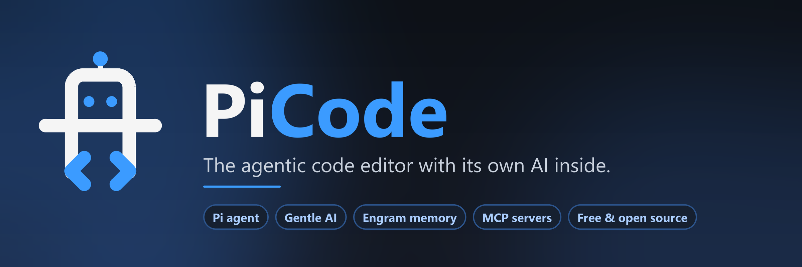
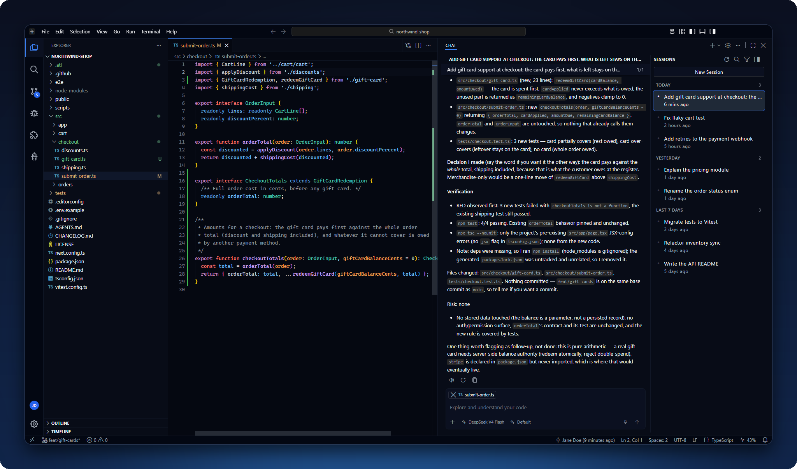
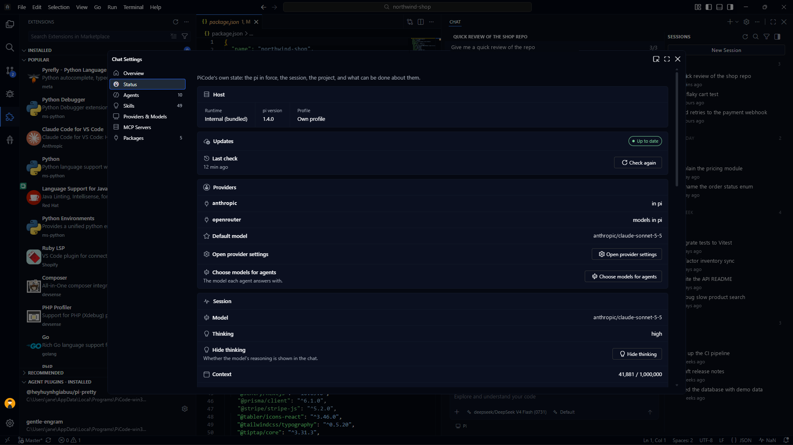

<!-- markdownlint-disable MD033 MD041 -->
<div align="center">



<h3>The code editor with its own AI inside.</h3>

<p>Not an assistant you install afterwards — open it, connect a provider,<br />and the agent already has its tools, its skills and its memory.</p>

<p>
<a href="https://github.com/Tomas-Platero/PiCode/releases"></a>
&nbsp;
<a href="https://www.getpicode.app"></a>
</p>

<p>
<a href="https://github.com/Tomas-Platero/PiCode/releases"></a>
<a href="#-get-started"></a>
<a href="./LICENSE"></a>
<a href="https://github.com/Tomas-Platero/PiCode/wiki"></a>
</p>

<br />


</div>

<br />

<table>
<tr>
<td align="center" width="33%">

### 🆓
**Free and open source**<br />
<sub>The whole editor, no account needed</sub>

</td>
<td align="center" width="33%">

### 🔌
**Your own AI**<br />
<sub>API keys or your ChatGPT, Claude or Copilot plan</sub>

</td>
<td align="center" width="33%">

### 🧠
**Memory that stays**<br />
<sub>Your agent remembers between conversations</sub>

</td>
</tr>
</table>


## 🤖 Agent or Editor — you choose

<table>
<tr>
<td width="50%" valign="top">

#### 🤖 Agent
The conversation in the middle. Sessions and projects on the left; Status, files, changes and the terminal on the right. *(Above.)*

</td>
<td width="50%" valign="top">

#### 🧑‍💻 Editor
The VS Code you already know, with the chat one click away. Switch any time with the robot button — no restart.

</td>
</tr>
</table>




## ✨ Built for working with an agent

### 💬 Subagents you can follow

Hand a job to a subagent and watch every step it takes, while the chat carries on. Reasoning, commands and results stay in view.


<table>
<tr>
<td width="55%" valign="middle">

### 🧭 Status, always at hand

Where the agent works, your MCP servers, what changed, the tasks it has running, your issues and what your memory holds — one column, one glance.

</td>
<td width="45%" align="center">

</td>
</tr>
</table>

### ⚙️ Everything about your agent, in one window

Agents, skills, providers and models, MCP servers and packages. See which pi answers, update it, and pick the model each agent uses.



### 🎯 And also

<table>
<tr>
<td width="33%" valign="top"><b>🧩 MCP servers</b><br /><sub>Add, edit or switch off your agent's external tools from one screen.</sub></td>
<td width="33%" valign="top"><b>🗂️ Sessions</b><br /><sub>Every conversation is kept. Search it, reopen it, continue it.</sub></td>
<td width="33%" valign="top"><b>🔄 One-click updates</b><br /><sub>The editor, pi, its packages, Gentle AI and Engram — each with its own button.</sub></td>
</tr>
<tr>
<td width="33%" valign="top"><b>🚀 Guided setup</b><br /><sub>Layout, provider and theme in one window, in your computer's language.</sub></td>
<td width="33%" valign="top"><b>🎁 What's new, to try</b><br /><sub>Each update explains itself with demos you can touch.</sub></td>
<td width="33%" valign="top"><b>🌍 13 languages</b><br /><sub>From Spanish and Japanese to Polish and Chinese.</sub></td>
</tr>
</table>


## ⚡ Get started

<table>
<tr>
<td align="center" width="33%"><h3>1️⃣</h3><b>Download</b><br /><sub>The latest <a href="https://github.com/Tomas-Platero/PiCode/releases">release</a>: installer or portable zip.</sub></td>
<td align="center" width="33%"><h3>2️⃣</h3><b>Open</b><br /><sub>Run <code>PiCode.exe</code> and go through the setup.</sub></td>
<td align="center" width="33%"><h3>3️⃣</h3><b>Chat</b><br /><sub>Connect a provider and ask for your first change.</sub></td>
</tr>
</table>

> [!NOTE]
> Windows only for now.


## ☁️ Free and Pro

**The editor is free, complete and open source.** Pro adds what lives in the cloud.

<table>
<tr>
<td width="50%" valign="top">

| | Free | Pro |
| --- | :---: | :---: |
| Editor, chat and agent | ✅ | ✅ |
| PiCode account | ✅ | ✅ |
| Cloud sync, encrypted | — | ✅ |
| Last week of chats, anywhere | — | ✅ |
| GitHub and Jira issues | — | ✅ |

<sub>See the [plans](https://www.getpicode.app/pricing).</sub>

</td>
<td width="50%" valign="top">

**🐞 Issues → fixes.** Your GitHub and Jira issues inside the editor, a board you can drag, and *Fix with pi* to hand one to the agent.


</td>
</tr>
</table>


## 📦 More

<details>
<summary><b>📡 Release channels</b></summary>

<br />

Three channels share the same code, each on its own branch: **stable** (recommended), **beta** (`-beta`, early access) and **experimental** (`-experimental`, the freshest work). Each has its own update feed — [choose a channel](https://www.getpicode.app/#download).

</details>

<details>
<summary><b>🔏 Code signing and privacy</b></summary>

<br />

Windows builds are signed with a free certificate: *Free code signing provided by [SignPath.io](https://signpath.io), certificate by [SignPath Foundation](https://signpath.org).*

- **Only official builds are signed.** Every release is built from this repository by GitHub Actions and signed from that same run; nothing built on a personal machine is signed.
- **Team roles.** [Tomás Platero](https://github.com/Tomas-Platero) is the author, reviewer and approver of every signing request.
- **Privacy.** PiCode only talks to other systems when asked: it checks `getpicode.app` for updates, signs in to your PiCode Account, syncs your settings if you have Pro, and sends prompts to the AI providers you configure. Nothing else leaves your computer. See the [privacy policy](https://www.getpicode.app/legal/privacy).

</details>

<details>
<summary><b>🛠️ Building from source</b></summary>

<br />

One clone has everything: the editor's source is versioned here, with the product identity already applied.

```bash
./build/build.sh          # full build, dependencies installed once
./build/build.sh -o       # fast correctness check — nothing installed or compiled
```

Prefer buttons? [`build/build-window.cmd`](build/build-window.cmd) opens a small window that drives the same pipeline. Details in the [Contributing docs](CONTRIBUTING.md), the [build guide](build/README.md) and [howto-build](docs/howto-build.md).

**Versions.** PiCode's own version is the one you are offered. The editor reports VS Code's number so extensions keep installing. Both live in [`product.json`](./product.json); the reasoning is in [ADR-016](./docs/DECISIONS.md). Releases are built by GitHub Actions — see [docs/CI.md](docs/CI.md).

</details>

<br />

<div align="center">

### 🙏 Built on open source

<p><a href="https://github.com/VSCodium/vscodium"></a> <a href="https://pi.dev"></a> <a href="https://github.com/Gentleman-Programming/gentle-ai"></a> <a href="https://github.com/Gentleman-Programming/engram"></a> <a href="https://www.electronjs.org"></a></p>

<sub>The editor comes from [VSCodium](https://github.com/VSCodium/vscodium) / [VS Code](https://github.com/microsoft/vscode), the agentic loop from [Pi](https://pi.dev), and the method, subagents and memory from [Gentle AI](https://github.com/Gentleman-Programming/gentle-ai) and [Engram](https://github.com/Gentleman-Programming/engram) by [Gentleman Programming](https://github.com/Gentleman-Programming). Full attribution in [`docs/DISTRIBUTION.md`](docs/DISTRIBUTION.md). PiCode is an independent project.</sub>

<br /><br />

Made by [Tomás Platero](https://tomasplatero.com)

</div>
