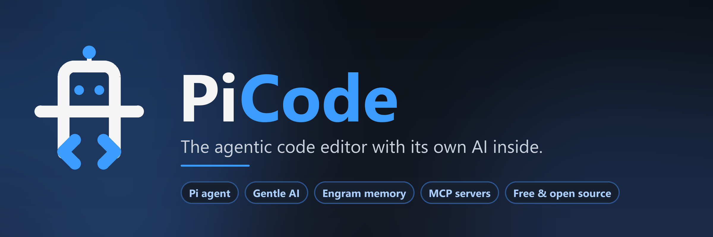

<!-- markdownlint-disable MD033 MD041 -->
<div align="center">



<br />

[](./LICENSE)
[](./product.json)
[](https://github.com/Tomas-Platero/PiCode/releases)

[](#download)
[](https://www.getpicode.app)
[](https://github.com/Tomas-Platero/PiCode/wiki)
[](./.nvmrc)
[](./)

[](https://github.com/Tomas-Platero/PiCode/actions/workflows/ci.yml?query=branch%3Amaster)
[](https://github.com/Tomas-Platero/PiCode/commits/master)
[](https://github.com/Tomas-Platero/PiCode/stargazers)
[](https://github.com/Tomas-Platero/PiCode/forks)
[](https://github.com/Tomas-Platero/PiCode/issues)
[](https://github.com/Tomas-Platero/PiCode/graphs/contributors)
[](CONTRIBUTING.md)
[](./package.json)

</div>

<br />

> **An agentic code editor with its own AI inside — not an assistant you install afterwards.**
>
> Open it, sign in, and the agent already knows your providers, your memory and your skills. No setup ceremony, no Copilot.

<br />

**The editor is free and complete.** No local feature is held back and it is 100% open source. It needs no account: bring your own provider keys or subscriptions. The only paid thing is the optional cloud sync of your setup (see *PiCode Account* below).

**Versions.** PiCode's own version (the badge above; `-beta` and `-experimental` on the pre-release channels) is the one you are offered. The editor *reports* `1.142.x` so extensions that require `engines.vscode: ^1.142.0` keep installing, while the source tree descends from VS Code `1.135.0`. Both numbers live in [`product.json`](./product.json); the reasoning is in [ADR-016](./docs/DECISIONS.md).

| 👤 Just want to use it | 👨‍💻 Want to build or contribute |
| --- | --- |
| [Download a release](https://github.com/Tomas-Platero/PiCode/releases) · unzip · run `PiCode.exe` · [getpicode.app](https://www.getpicode.app) | [Wiki](https://github.com/Tomas-Platero/PiCode/wiki) · [Source build guide](#building-from-source) · [Contributing docs](CONTRIBUTING.md) |

<br />

## ✨ What you get

| | |
| --- | --- |
| 💬 **AI chat, built in** | An agentic assistant that lives in the editor: streaming answers, tools, reasoning, your project's context. It reads your code, edits files, runs commands — and asks before it does. |
| 🔌 **Your AI providers** | Connect with an API key or an OAuth subscription (ChatGPT, Claude, Copilot, Grok, Kimi, Meta, OpenRouter…), or declare a compatible endpoint with your own base URL. Pick the model per conversation. |
| 🚀 **First-run setup** | A window of its own, before the editor: choose which pi answers (the built-in one or yours), connect a provider, pick a theme, decide a few extras — and, if you want, leave your PiCode account sign-in requested. Nothing opens until you finish or skip it, and `PiCode: Setup` reopens the same window later. |
| 🎨 **Themes** | Every card in the setup is painted in the theme's own colours, so the choice is what you see. More themes are installed as extensions, from the editor. |
| 🧩 **MCP servers, in one place** | Your agent's external tools live in one screen: add a server, edit it, switch it off or remove it. pi calls them through the editor, so its confirmations and permissions apply — you are asked before one of their tools runs. |
| 📊 **A status panel that tells the truth** | Which pi is answering, its version, your providers, every MCP server and its state, the model and thinking level in use, what the session has cost, the tokens and cache it has used, the plan the agent is working through, your project's branch and changes. |
| 🧠 **Gentle AI, built in** | PiCode runs on [Gentle AI](https://github.com/Gentleman-Programming/gentle-ai): its method (Organic-Driven Development), its specialised subagents and its review tools come with the editor, and its [Engram](https://github.com/Gentleman-Programming/engram) memory is what your agent remembers between conversations. Made by [Gentleman Programming](https://github.com/Gentleman-Programming). |
| 🗂️ **Sessions** | Every conversation is kept per project. Search them, reopen them, read any transcript. |
| ☁️ **PiCode Account** | Sign in and your settings, extensions, AI configuration and your agent's memory follow you to any machine — encrypted in transit and at rest. |

<br />

## ☁️ PiCode Account

Create a free account, and add **Pro** when you want your editor the same
everywhere:

- **Settings, extensions and AI configuration** — synced and encrypted.
- **Your agent's memory and skills** — the setup that took hours, kept.
- **Last week of conversations** — always with you, a rolling window that cleans itself.
- **Three ways in** — email, Google or GitHub.

The account is free and links your editor to it. **Cloud sync is a Pro
feature**: the free plan stores nothing. See [plans](https://www.getpicode.app/pricing).

<a id="download"></a>

## ⬇️ Download

Grab the latest release from [GitHub Releases](https://github.com/Tomas-Platero/PiCode/releases) — the **installer** (`PiCode-win32-x64-…-setup.exe`) or a portable **zip**: unzip, run `PiCode.exe`. Windows only today.

Three channels share the same code, each on its own branch of this repo: **stable** (recommended, no suffix), **beta** (`-beta`, early access to what is coming) and **experimental** (`-experimental`, built from the freshest work). Each has its own update feed, so switching channels is switching branches — [choose a channel](https://www.getpicode.app/#download).

### 🔏 Code signing policy

Windows builds are signed with a free certificate: *Free code signing provided by [SignPath.io](https://signpath.io), certificate by [SignPath Foundation](https://signpath.org).*

- **Only official builds are signed.** Every release is built from this repository by GitHub Actions and signed from that same run; nothing built on a personal machine is signed.
- **Team roles.** [Tomás Platero](https://github.com/Tomas-Platero) is the author, reviewer and approver of every signing request.
- **Privacy.** PiCode only talks to other systems when asked: it checks `getpicode.app` for updates, signs in to your PiCode Account, syncs your settings if you have Pro, and sends prompts to the AI providers you configure. Nothing else leaves your computer. See the [privacy policy](https://www.getpicode.app/legal/privacy).

<a id="building-from-source"></a>

## 🛠️ Building from source

One clone has everything — the editor's source is versioned here, with the product identity already applied. The build is a five-phase chain that finishes in minutes on a steady state:

```text
prepare → connector → compile → pack → stage
```

```bash
./build/build.sh          # full build, dependencies installed once
./build/build.sh -o       # fast correctness check — nothing installed or compiled
```

Prefer buttons? [`build/build-window.cmd`](build/build-window.cmd) opens a small window that drives the same pipeline. Full dependency list and troubleshooting in the [Contributing docs](CONTRIBUTING.md), the [build guide](build/README.md) and [howto-build](docs/howto-build.md).

Releases are built and published by GitHub Actions: bump the version in [`product.json`](./product.json), tag `v<version>`, push — the [release workflow](./.github/workflows/release.yml) builds, publishes the release with its SHA-256, generates the update feed and verifies it live. The version rule is the one above: a release moves the editor's number too (its patch, or the base when upstream moves) — because the updater compares the editor's number. The tag, the release title and the zip carry PiCode's version. Details in [docs/CI.md](docs/CI.md).

## 🙏 Credits

PiCode stands on open source: [VSCodium](https://github.com/VSCodium/vscodium) / [VS Code — MIT source](https://github.com/microsoft/vscode) for the editor, the [Pi](https://pi.dev) coding agent for the agentic loop, and [Gentle AI](https://github.com/Gentleman-Programming/gentle-ai) with its [Engram](https://github.com/Gentleman-Programming/engram) memory — both MIT, by [Gentleman Programming](https://github.com/Gentleman-Programming) — for the method, the subagents and the memory. Thank you. Full attribution in [`docs/DISTRIBUTION.md`](docs/DISTRIBUTION.md). PiCode is an independent project.

<br />
<div align="center">

Made by [Tomás Platero](https://tomasplatero.com)

</div>
