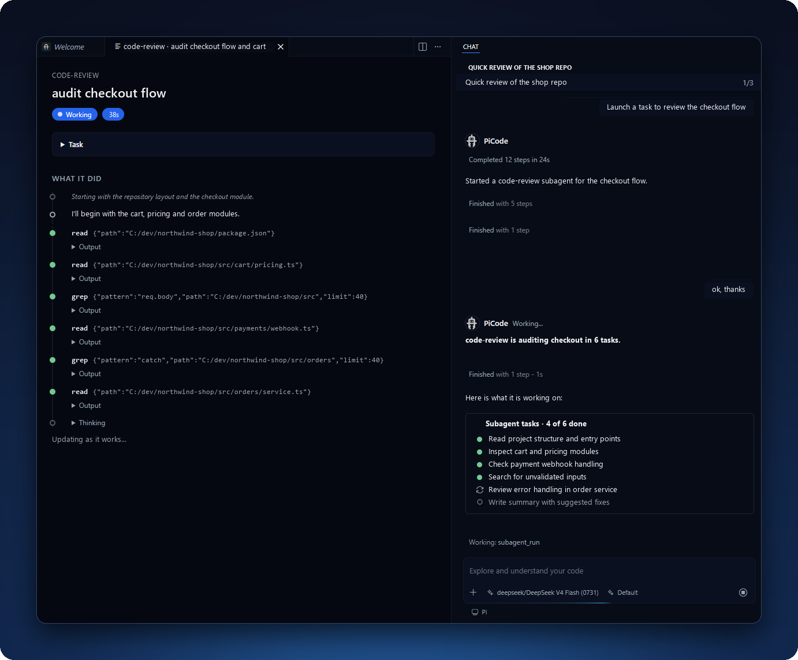

<!-- markdownlint-disable MD033 MD041 -->
<div align="center">


### The code editor with its own AI inside — not an assistant you install afterwards.

Open it, connect a provider, and the agent already has its tools, its skills and its memory.

<br />

[](https://github.com/Tomas-Platero/PiCode/releases)
&nbsp;
[](https://www.getpicode.app)

[](https://github.com/Tomas-Platero/PiCode/releases)
[](https://github.com/Tomas-Platero/PiCode/actions/workflows/ci.yml?query=branch%3Aexperimental)
[](./LICENSE)
[](https://github.com/Tomas-Platero/PiCode/wiki)

</div>

<br />

## 🤖 Two ways to work

Pick one in the setup, switch any time with the robot button at the top right. No restart.

<table>
<tr>
<td width="50%" valign="top">

**Agent** — the conversation in the middle. Sessions and projects on the left, *Status*, files, changes and the terminal on the right.


</td>
<td width="50%" valign="top">

**Editor** — the VS Code you already know, with the chat one click away.

<br /><br />


</td>
</tr>
</table>

## ✨ What you get

<table>
<tr>
<td width="60%"></td>
<td valign="middle">

### 💬 AI chat with subagents

It reads your code, edits files and runs commands. Hand a job to a subagent and follow every step it takes, while your memory keeps what matters between conversations.

</td>
</tr>
<tr>
<td valign="middle">

### 🧭 Status, always at hand

Where the agent works, your MCP servers, what changed, the tasks it has running, your issues and what your memory holds — in one column.

</td>
<td width="30%" align="center"></td>
</tr>
<tr>
<td width="60%"></td>
<td valign="middle">

### ⚙️ Everything about your agent, in one window

Agents, skills, providers and models, MCP servers and packages. See which pi answers, update it, and pick the model each agent uses.

</td>
</tr>
</table>

### And also

| | |
| --- | --- |
| 🔌 **Your AI providers** | API key or subscription: ChatGPT, Claude, Copilot, Grok, Kimi, OpenRouter… or your own endpoint. Pick the model per conversation. |
| 🧠 **Gentle AI inside** | [Gentle AI](https://github.com/Gentleman-Programming/gentle-ai)'s subagents and review tools come with the editor, and [Engram](https://github.com/Gentleman-Programming/engram) is what your agent remembers between conversations. |
| 🧩 **MCP servers** | Add, edit, switch off or remove your agent's external tools from one screen. |
| 🗂️ **Sessions** | Every conversation is kept. Search it, reopen it, continue it. |
| 🔄 **Everything updates from the app** | The editor, pi, its packages, Gentle AI and Engram — each with its own *Update* button. |
| 🌍 **13 languages** | Czech, German, Spanish, French, Italian, Japanese, Korean, Polish, Portuguese (Brazil), Russian, Turkish and Chinese (Simplified and Traditional). |

## ⚡ Get started

1. **Download** the latest [release](https://github.com/Tomas-Platero/PiCode/releases): the installer or the portable zip.
2. **Open** `PiCode.exe` and go through the setup.
3. **Connect** a provider and start a chat.

> [!NOTE]
> Windows only for now.

## ☁️ Free and Pro

**The editor is free, complete and open source.** It needs no account: bring your own provider keys or subscriptions.

| | Free | Pro |
| --- | :---: | :---: |
| The whole editor, chat and agent | ✅ | ✅ |
| PiCode account (email, Google or GitHub) | ✅ | ✅ |
| Cloud sync of settings, extensions and AI setup, encrypted | — | ✅ |
| Last week of conversations on any machine | — | ✅ |
| GitHub and Jira issues in the editor, with *Fix with pi* | — | ✅ |


See the [plans](https://www.getpicode.app/pricing).

## 📦 More

<details>
<summary><b>Release channels</b></summary>

<br />

Three channels share the same code, each on its own branch: **stable** (recommended), **beta** (`-beta`, early access) and **experimental** (`-experimental`, the freshest work). Each has its own update feed — [choose a channel](https://www.getpicode.app/#download).

</details>

<details>
<summary><b>🔏 Code signing and privacy</b></summary>

<br />

Windows builds are signed with a free certificate: *Free code signing provided by [SignPath.io](https://signpath.io), certificate by [SignPath Foundation](https://signpath.org).*

- **Only official builds are signed.** Every release is built from this repository by GitHub Actions and signed from that same run; nothing built on a personal machine is signed.
- **Team roles.** [Tomás Platero](https://github.com/Tomas-Platero) is the author, reviewer and approver of every signing request.
- **Privacy.** PiCode only talks to other systems when asked: it checks `getpicode.app` for updates, signs in to your PiCode Account, syncs your settings if you have Pro, and sends prompts to the AI providers you configure. Nothing else leaves your computer. See the [privacy policy](https://www.getpicode.app/legal/privacy).

</details>

<details>
<summary><b>🛠️ Building from source</b></summary>

<br />

One clone has everything: the editor's source is versioned here, with the product identity already applied.

```bash
./build/build.sh          # full build, dependencies installed once
./build/build.sh -o       # fast correctness check — nothing installed or compiled
```

Prefer buttons? [`build/build-window.cmd`](build/build-window.cmd) opens a small window that drives the same pipeline. Details in the [Contributing docs](CONTRIBUTING.md), the [build guide](build/README.md) and [howto-build](docs/howto-build.md).

**Versions.** PiCode's own version is the one you are offered. The editor reports VS Code's number so extensions keep installing. Both live in [`product.json`](./product.json); the reasoning is in [ADR-016](./docs/DECISIONS.md). Releases are built by GitHub Actions — see [docs/CI.md](docs/CI.md).

</details>

## 🙏 Credits

PiCode stands on open source: [VSCodium](https://github.com/VSCodium/vscodium) / [VS Code — MIT source](https://github.com/microsoft/vscode) for the editor, the [Pi](https://pi.dev) coding agent for the agentic loop, and [Gentle AI](https://github.com/Gentleman-Programming/gentle-ai) with its [Engram](https://github.com/Gentleman-Programming/engram) memory — both MIT, by [Gentleman Programming](https://github.com/Gentleman-Programming). Thank you. Full attribution in [`docs/DISTRIBUTION.md`](docs/DISTRIBUTION.md). PiCode is an independent project.

<br />
<div align="center">

Made by [Tomás Platero](https://tomasplatero.com)

</div>
