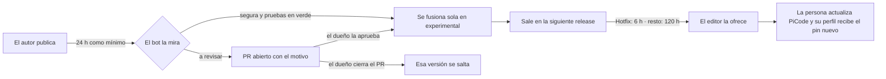

# 📌 Las piezas fijadas de Gentle AI: cómo se mantienen al día

Cómo llega una versión nueva de gentle-pi, gentle-engram, pi-intercom o del motor de engram
desde que su autor la publica hasta el perfil de cada persona. La decisión está en
[ADR-035](DECISIONS.md); la frase del dueño y su traducción, en [`AGENTS.md`](../AGENTS.md).

> *"habría tener un sistema para poder actualizar gentle-ai aunque sea casi automatizado o full automatizado, ya que tenemos pinneado esto."*

## 🧭 La idea

Las cuatro piezas van **fijadas a versión exacta**: quien instala PiCode recibe justo las versiones
con las que se probó, y su perfil nunca se mueve solo a una que nadie miró. Fijado no quiere decir
congelado: un bot propone cada versión nueva, y la mayoría entra sin que nadie tenga que hacer nada.

| Pieza | Dónde está fijada | Qué es |
| --- | --- | --- |
| 🧠 `gentle-pi` | `extensions/picode/src/product-packages.ts` | el método, los agentes, las skills y la revisión |
| 🗂️ `gentle-engram` | `extensions/picode/src/product-packages.ts` | el lado de pi de la memoria |
| 💬 `pi-intercom` | `extensions/picode/src/product-packages.ts` | que las sesiones de pi se hablen |
| 🗄️ motor de engram | `build/distribution/engram.json` | el programa de la memoria (`engram.exe`) |

Pi en sí (`build/distribution/runtime.json`) **no** entra en este sistema: sus subidas llevan una
revisión escrita a mano y viajan siempre en release completa.

## 🛤️ El recorrido, en tres momentos



### 1️⃣ El bot la da por buena (en el repositorio)

Una vez al día (`.github/workflows/pins.yml`, 06:17 UTC), para cada pieza:

1. Busca la versión **estable** más nueva que lleve **al menos 24 horas** publicada. Una versión
   rota o comprometida suele retirarse en unas horas.
2. En npm, **nunca por encima de la etiqueta `latest`**. Lo que el autor publica como `candidate` o
   `next` todavía no lo ha dado por terminado (el 2026-10-29, gentle-engram 0.5.1 estaba así y no se
   cogió).
3. Compara los dos paquetes publicados y decide si es **segura** o **a revisar** (tabla de abajo).
4. Mueve el pin (y los tests que nombran la versión) y pasa las pruebas del conector.
5. Abre un PR contra `experimental` en su propia rama, `bot/pin-<pieza>`:
   - **segura y pruebas en verde** → se fusiona sola;
   - **cualquier otra cosa** → se queda abierto, con el motivo escrito en la descripción.

Hasta aquí **no le ha llegado a nadie**: solo ha cambiado el código.

### 2️⃣ Sale en una release (el dueño)

Lo fusionado viaja con la siguiente release del canal, como cualquier otro cambio. El bot no
publica releases. Una subida de los paquetes de pi cabe en un **Hotfix** (es código del conector);
la del motor de engram, no: va siempre en una **Release** completa ([HOTFIX.md](HOTFIX.md)).

### 3️⃣ El editor la ofrece a cada persona

Publicada la release, el editor no la ofrece al momento ([HOTFIX.md](HOTFIX.md)):

| Etiqueta de la release | Se ofrece a las |
| --- | --- |
| **Hotfix** (p. ej. gentle-pi 4.5.0 → 4.5.1) | 6 h |
| **Minor update** o **Release** (el motor de engram siempre) | 120 h (5 días) |

Cuando la persona actualiza PiCode, el editor pone en su perfil **la versión exacta nueva** antes de
que pi cargue nada (al abrir el chat, en el asistente de primer arranque, al cambiar de modelo…), y
la instala si falta. Si una importación o una edición a mano había dejado otra versión, se corrige.
El editor no tiene botón para actualizar una pieza fijada por su cuenta: el pin volvía a poner la
anterior, así que se quitó (ADR-031, adenda 5).

**Tiempo mínimo** desde que el autor publica hasta que alguien la recibe: unas **30 horas** en un
arreglo pequeño (24 h + 6 h), más lo que tarde en salir la release.

## 🔎 Segura o a revisar

Una versión es **segura** cuando no se cumple ninguna de estas. Si se cumple alguna, espera revisión
y el PR lo dice:

| Motivo | Por qué para |
| --- | --- |
| Salto mayor (`4.x` → `5.0`), o de menor en un `0.x` (`0.18` → `0.19`) | el propio autor avisa de que puede romper |
| Una extensión nueva que pi cargaría | código nuevo; si es solo de terminal hay que filtrarla (pasó en gentle-pi 4.4.0 con `gentle-music`, `gentle-voice` y `gentle-design`) |
| Cambia el manifiesto de pi del paquete | carga otras carpetas |
| Cambia un script de instalación (`postinstall`…) | se ejecuta en cada instalación |
| Dependencias nuevas | código de terceros que no estaba |
| Su rango de pi ya no incluye el pi que lleva el producto | no funcionaría con nuestro pi |
| **Es el motor de engram** | su almacén, `~/.engram`, es compartido con otros agentes y un motor nuevo puede migrarlo. Siempre espera |

Del motor de engram, además, se descargan los dos zip de Windows y se comprueban contra el
`checksums.txt` de su release antes de escribir sus SHA-256. El campo `note` de `engram.json` lo
reescribe una persona al aprobarlo.

## 👤 Qué hace el dueño

| Quiero… | Hago |
| --- | --- |
| aceptar una que espera revisión | revisar el PR (y, si trae una extensión de terminal, añadirla al filtro de `product-packages.ts`) y fusionarlo |
| **decir «esta no»** | cerrar el PR sin fusionar: el bot no vuelve a proponer esa versión, sí la siguiente |
| que salga ya a la gente | sacar la release del canal como siempre |
| lanzarlo sin esperar al día siguiente | *Actions → Pins → Run workflow* |

Una versión más nueva que llega mientras un PR espera **refresca el mismo PR**; no se acumulan.

## 🧰 A mano

```bash
node build/pins.mjs check
```

Qué hay nuevo para cada pieza (`--min-age 0` para ver también lo publicado hace menos de 24 h).

```bash
node build/pins.mjs audit gentle-pi 4.3.0 4.4.0
```

Qué cambia entre dos versiones, sin escribir nada.

```bash
node build/pins.mjs bump gentle-pi
```

Mueve el pin en el árbol y dice si es segura. Las reglas tienen sus pruebas en
`build/pins.test.mjs`.

## ⚠️ Límites

- El flujo programado **solo corre cuando `pins.yml` está en `master`** (GitHub solo programa los
  flujos de la rama por defecto). Hasta entonces, a mano.
- La comparación **lee** el paquete, no lo ejecuta: una extensión que ya existía y cambia por dentro
  pasa como segura si lo demás encaja. Lo que la cubre son las pruebas del conector y que entra
  primero por el canal experimental.
- Un PR abierto con el token del flujo no arranca CI; por eso las pruebas del conector se pasan
  dentro del propio flujo antes de fusionar.
