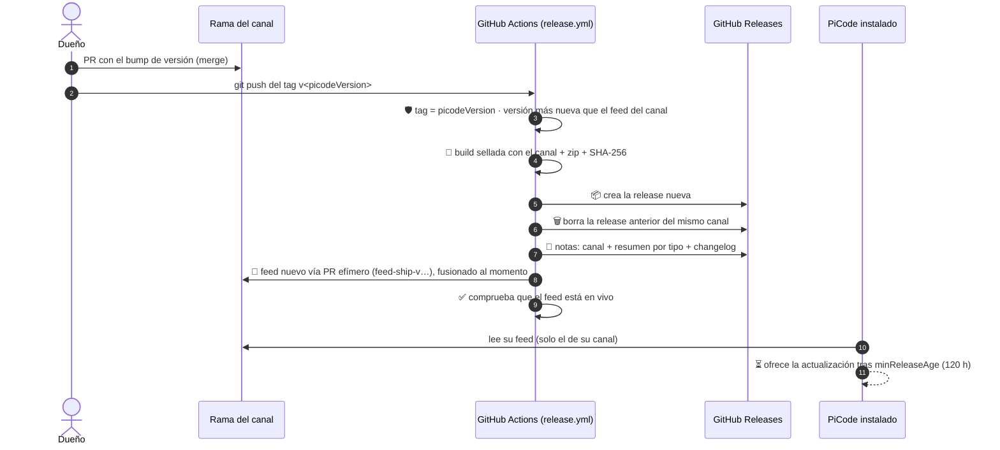

# 🚀 Releases: de experimental a stable

Cómo viaja un cambio desde que entra en **experimental** hasta que lo recibe todo el mundo en
**stable**. Las reglas de cada pieza viven en su sitio: los canales en
[ADR-015](DECISIONS.md), el workflow en [`CI.md`](CI.md), los feeds en
[`DISTRIBUTION.md`](DISTRIBUTION.md) y [`updates/README.md`](../updates/README.md).

## 🗺️ El viaje de un vistazo

```mermaid
flowchart LR
    dev["💻 Trabajo nuevo<br/>(PR a experimental)"]

    subgraph EXP["🧪 experimental"]
        direction TB
        e1["bump picodeVersion<br/>0.3.0-experimental"]
        e2["🏷️ tag v0.3.0-experimental"]
        e3["📦 release + feed<br/>updates/experimental/"]
        e1 --> e2 --> e3
    end

    subgraph BETA["🟡 beta"]
        direction TB
        b1["merge experimental → beta<br/>picodeVersion 0.3.0-beta"]
        b2["🏷️ tag v0.3.0-beta"]
        b3["📦 release + feed<br/>updates/beta/"]
        b1 --> b2 --> b3
    end

    subgraph STABLE["🟢 stable (master)"]
        direction TB
        s1["merge beta → master<br/>picodeVersion 0.3.0"]
        s2["🏷️ tag v0.3.0"]
        s3["📦 release + feed<br/>updates/stable/"]
        s1 --> s2 --> s3
    end

    dev --> e1
    e3 -- "probado ✅" --> b1
    b3 -- "probado ✅" --> s1
    s3 --> users["👥 Todos los usuarios<br/>(en hasta 5 días)"]
```



Y lo que hace el pipeline por dentro cada vez que se empuja un tag, sea del canal que sea:



## 🚦 Los tres canales

| Canal | Rama | Sufijo del tag | Para quién |
| --- | --- | --- | --- |
| 🧪 **Experimental** | `experimental` | `-experimental` | Donde aterriza todo primero; puede romperse |
| 🟡 **Beta** | `beta` | `-beta` | Lo que viene, ya pasado por experimental |
| 🟢 **Stable** | `master` | *(ninguno)* | Todo el mundo; lo que el updater ofrece por defecto |

Cada canal se instala **al lado** de los otros (carpeta, perfil y AppId propios) y **solo lee
su propio feed**: un usuario de stable nunca recibe una beta, aunque el pipeline se equivoque.

## 🔢 Las dos versiones de `product.json`

Hay que mover **las dos** en cada release, o el pipeline se para:

| Campo | Qué es | Regla |
| --- | --- | --- |
| `picodeVersion` | El nombre de la release (`0.3.0-beta`). Lo que ve el usuario. | El sufijo dice el canal. Su número debe ser **mayor** que el de la última release **de ese canal**. El tag es `v<picodeVersion>`. |
| `version` | El número del editor (`1.142.1`). Lo que compara el updater. | Debe ser **mayor** que el que tiene el feed **del canal destino**. Si no crece, nadie recibe la actualización. |

> 💡 Cada canal compite solo consigo mismo: `0.3.0` (stable) no es "más nuevo" que
> `0.3.0-beta`, pero es la release que va después. Por eso la comparación se hace contra el
> feed del propio canal, no contra la última release del repositorio.

## 🧪 Paso 1 — Publicar en experimental

1. El trabajo entra en `experimental` por **pull request** (ninguna rama acepta push directo
   salvo Admin).
2. Un PR de release sube `picodeVersion` (p. ej. `0.3.0-experimental`) y, si hace falta,
   `version`.
3. Tras el merge, el tag:

   ```bash
   git tag v0.3.0-experimental && git push origin v0.3.0-experimental
   ```

4. El workflow **Release** hace el resto (ver el segundo gráfico). Se instala la build
   experimental y se prueba.

## 🟡 Paso 2 — Promocionar a beta

Cuando experimental está bien probado:

1. Rama de promoción desde `beta` (p. ej. `promote/experimental-to-beta`) y **merge de
   `experimental`** dentro.
2. Al resolver el merge, **gana experimental en todo el código**, salvo lo que hace que beta
   sea beta:
   - `product.json → picodeVersion` pasa a `0.3.0-beta` (mismo número, sufijo del canal).
   - `product.json → version` se queda con el de experimental si ya es mayor que el del feed
     de beta; si no, se sube.
   - **`updates/` se queda con el de beta.** Nunca se copia el feed de otro canal: el
     pipeline lo avanza solo al publicar.
3. PR contra `beta`, merge, y tag `v0.3.0-beta`.
4. Mensaje del merge recomendado: `merge: beta takes the experimental work as v0.3.0-beta`,
   con las dos líneas de qué se quedó de beta.

## 🟢 Paso 3 — Promocionar a stable

El mismo movimiento, un escalón más arriba:

1. Rama desde `master`, **merge de `beta`** dentro.
2. Gana el código de beta; se queda de stable:
   - `picodeVersion` → `0.3.0` (sin sufijo).
   - `updates/` → el de `master`.
3. PR contra `master`, merge, tag `v0.3.0`.
4. Mensaje recomendado: `merge: stable takes the beta work as v0.3.0`.

## 🩹 Cómo le llega a cada persona

Cada release es una versión completa; además, si no toca el motor, las dependencias, pi ni la identidad del
producto, el pipeline publica un **zip pequeño** con solo lo que cambió respecto a la release anterior del
canal, lo prueba (build vieja + zip = build nueva) y lo anuncia en el feed junto a la etiqueta **Hotfix**,
**Minor update** o **Release**. Quien está en la versión anterior (portable) baja el pequeño; los demás, el
completo. Todo el detalle, en [`HOTFIX.md`](HOTFIX.md).

## 🛡️ Lo que el pipeline vigila solo

| Guardia | Si falla |
| --- | --- |
| El tag coincide con `v<picodeVersion>` | Se para: re-tag o corrige `product.json` |
| `picodeVersion` es más nueva que la última del canal | Se para: sube `picodeVersion` |
| `version` es más nueva que la del feed del canal | Se para: sube `version` |
| El generador del feed acepta la versión (nunca `--force`) | Se para |
| El feed queda en vivo en la rama del canal | Se reintenta 10 veces; si no, falla el run |
| El zip pequeño: firmado, equivalente a la build nueva | No se publica; la release sale entera |

Y además, en cada release:

- 🗑️ **Una sola release por canal**: la anterior del mismo canal se borra (con su tag)
  *después* de publicar la nueva, así el canal nunca se queda vacío.
- 📝 **Notas de release**: la descripción del canal
  ([`build/release-notes/<canal>.md`](../build/release-notes/)), encima un resumen agrupado por
  tipo de cambio con iconos y debajo el changelog de GitHub.
- 📦 **Solo pack portable** en local; el instalador, solo si se pide.

## ⏳ Cuándo le llega al usuario

El updater espera `update.minReleaseAge` (**120 h** por defecto) desde la publicación antes de
ofrecer la versión: una release puede tardar **hasta 5 días** en llegar. Es a propósito; nunca
se toca la fecha del feed para acelerarlo.

## ✅ Lista rápida de una promoción

- [ ] El canal de origen tiene su release publicada y probada.
- [ ] Rama de promoción creada desde el canal destino.
- [ ] Merge hecho: código del origen, `picodeVersion` con el sufijo del destino, `updates/`
      del destino.
- [ ] `version` mayor que la del feed del destino.
- [ ] PR fusionado en la rama del destino.
- [ ] Tag `v<picodeVersion>` empujado.
- [ ] Run de **Release** en verde y resumen revisado (versión, SHA-256, feed en vivo).
- [ ] En GitHub solo queda una release de ese canal.
